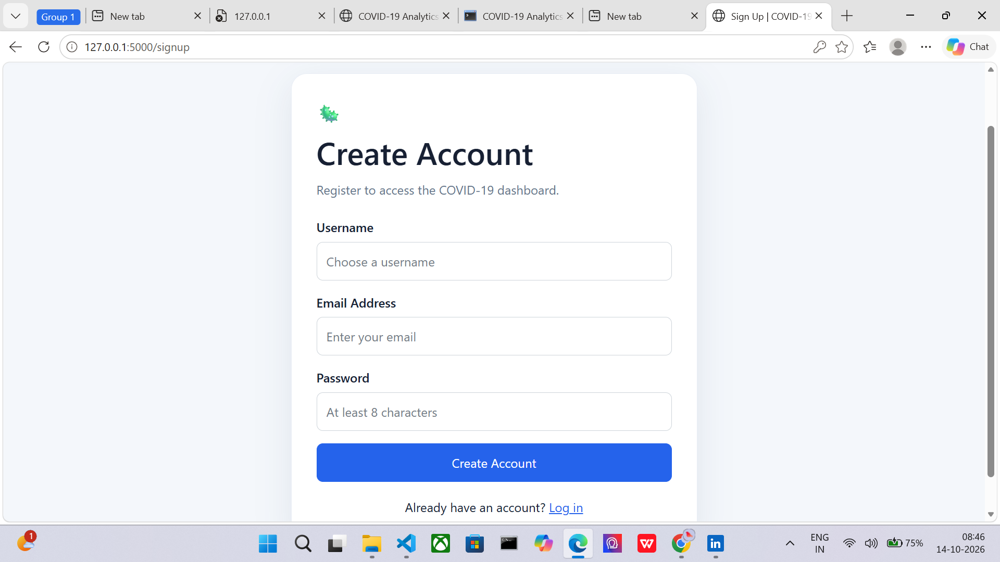
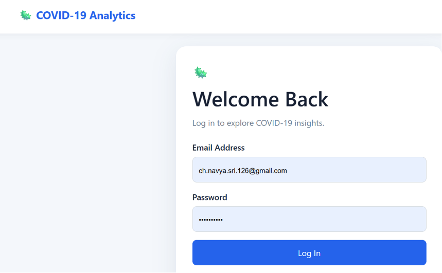
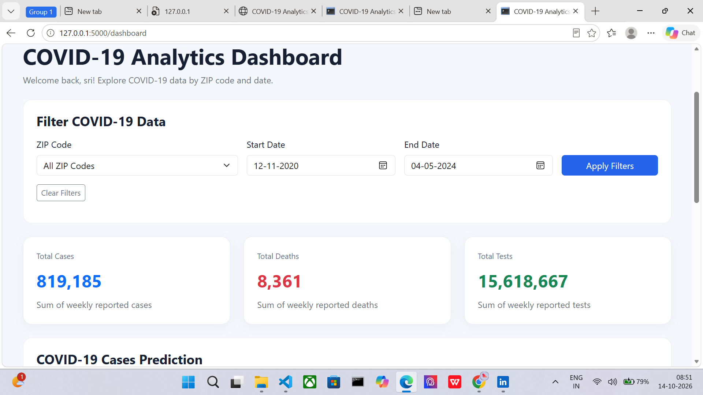
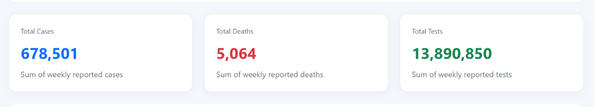
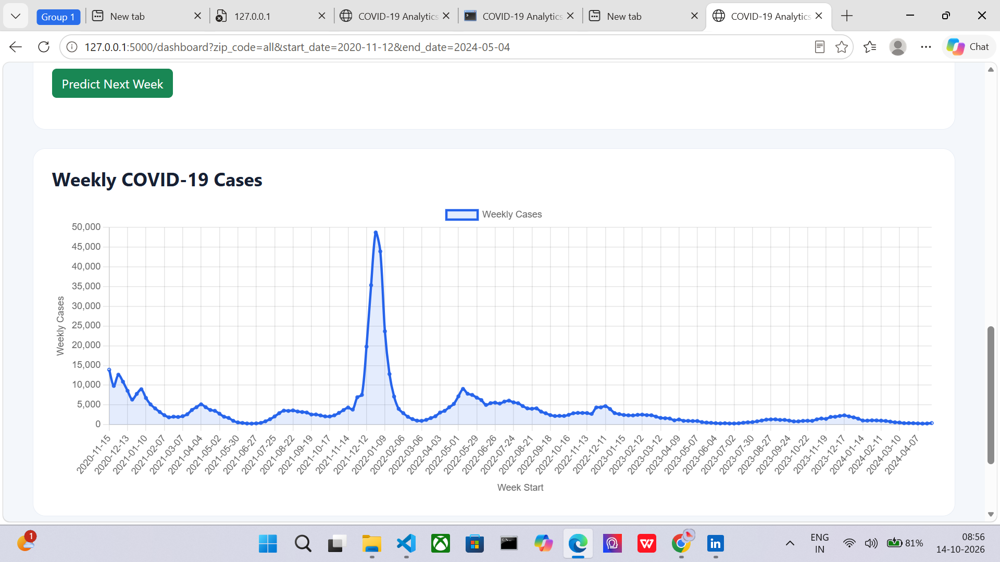
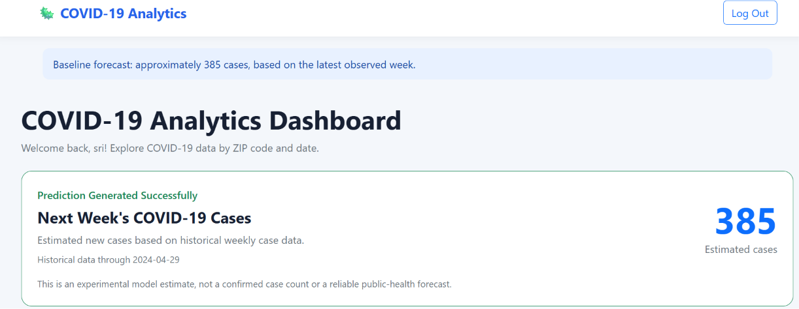

# COVID-19 Analytics Dashboard

A web-based application developed using Python and Flask to explore historical COVID-19 data, filter statistics by ZIP code and date range, visualize weekly case trends, and generate an experimental estimate of next week's cases.

## Table of Contents

- [Overview](#overview)
- [Features](#features)
- [Technologies Used](#technologies-used)
- [Project Structure](#project-structure)
- [Screenshots](#screenshots)
- [Installation and Setup](#installation-and-setup)
- [How to Run](#how-to-run)
- [Machine Learning and Prediction](#machine-learning-and-prediction)
- [Testing](#testing)
- [Limitations](#limitations)
- [Future Enhancements](#future-enhancements)
- [Conclusion](#conclusion)

## Overview

The COVID-19 Analytics Dashboard provides an interactive interface for exploring historical COVID-19 statistics. Users can create an account, log in, view summary statistics, filter data by ZIP code and date range, analyze weekly case trends, and generate an experimental estimate of the following week's cases.

## Features

- **User Authentication:** Sign-up, login, and logout functionality.
- **Summary Cards:** Displays total reported cases, deaths, and tests.
- **ZIP Code Filtering:** Explore data for all ZIP codes or a selected ZIP code.
- **Date Range Filtering:** Select start and end dates to analyze a specific period.
- **Historical Visualization:** Displays weekly COVID-19 cases in a line chart.
- **Case Prediction:** Generates an experimental estimate based on the latest observed weekly case count.
- **SQLite Database:** Stores application data locally.
- **Interactive Dashboard:** Presents statistics and charts in a user-friendly interface.

## Technologies Used

- [Python](https://www.python.org/) — programming language
- [Flask](https://flask.palletsprojects.com/) — web framework
- [Pandas](https://pandas.pydata.org/) — data manipulation and analysis
- [Scikit-learn](https://scikit-learn.org/) — machine-learning tools and evaluation
- [SQLite](https://www.sqlite.org/) — database
- HTML — page structure
- CSS — styling
- JavaScript — interactive web functionality and chart rendering

## Project Structure

```text
COVID19Project/
├── app.py
├── models.py
├── ml_model.py
├── covid_model.pkl
├── requirements.txt
├── README.md
├── data/
│   └── covid19.csv
├── instance/
│   └── covid19.db
├── templates/
│   ├── base.html
│   ├── dashboard.html
│   ├── login.html
│   └── signup.html
└── screenshots/
    ├── 01_signup_page.png
    ├── 02_login_page.png
    ├── 03_main_dashboard.png
    ├── 04_filters_applied.png
    ├── 05_historical_cases_chart.png
    └── 06_prediction_result.png
```

*Note: This is the intended structure based on the project files discussed. Keep it synchronized with the files actually present in your project.*

## Screenshots

### 1. Sign Up Page



### 2. Login Page



### 3. Main Dashboard



### 4. Filtered Results



### 5. Historical COVID-19 Cases Chart



### 6. Prediction Result



## Installation and Setup

### Prerequisites

- Python installed on your computer
- Visual Studio Code or another code editor
- Project source files and dataset

### Step 1: Open the Project

Open the `COVID19Project` folder in VS Code.

### Step 2: Create a Virtual Environment

If you do not already have a virtual environment, run:

```powershell
python -m venv .venv
```

### Step 3: Activate the Virtual Environment

On Windows PowerShell, run:

```powershell
.\.venv\Scripts\Activate.ps1
```

If PowerShell blocks activation, run the following commands in the current terminal session:

```powershell
Set-ExecutionPolicy -Scope Process -ExecutionPolicy RemoteSigned
.\.venv\Scripts\Activate.ps1
```

### Step 4: Install Dependencies

```powershell
python -m pip install -r requirements.txt
```

## How to Run

1. Open the project folder in VS Code.
2. Activate the virtual environment.
3. Start the Flask application:

   ```powershell
   python app.py
   ```

4. Open your browser and visit:

   [http://127.0.0.1:5000](http://127.0.0.1:5000)

5. Create an account if needed, log in, and explore the dashboard.

To stop the local development server, press `Ctrl + C` in the terminal.

## Machine Learning and Prediction

The dashboard generates an experimental estimate of next week's COVID-19 cases based on the latest observed weekly case count.

During testing, the dashboard displayed an example estimate of **385 cases**, with historical data through **2024-04-29**. The result may vary depending on the selected filters and available data.

The project also contains `ml_model.py` for model evaluation and `covid_model.pkl` as a saved model artifact.

A successful prediction does not guarantee accurate future forecasting. Model performance should be evaluated using time-based test periods and compared with simple forecasting baselines.

## Testing

The following application flows were manually tested:

- User sign-up and login
- Dashboard loading
- ZIP code filtering
- Date range filtering
- Next-week case estimation
- Historical COVID-19 cases chart
- Logout functionality

A successful sample prediction confirms that the prediction flow runs, but it does not by itself establish model accuracy.

## Limitations

- Predictions are experimental estimates, not confirmed future case counts.
- The available dataset ends in 2024, so the dashboard is not a real-time COVID-19 monitoring service.
- Results depend on the available dataset and selected filters.
- Model performance on one historical test period may not generalize to future periods or individual ZIP codes.
- The Flask development server is intended for local development, not production deployment.

## Future Enhancements

- Evaluate forecasting methods across multiple historical test periods.
- Compare additional forecasting algorithms.
- Improve automated test coverage.
- Enhance mobile responsiveness and accessibility.
- Add secure production deployment configuration.
- Document the dataset source and update frequency.

## Conclusion

The COVID-19 Analytics Dashboard combines web development, data analysis, visualization, and forecasting in one application. It demonstrates how Python and Flask can be used to build a data-driven web application for exploring historical COVID-19 statistics.

## Author

Developed as a Python, Flask, data-analysis, and forecasting project.
